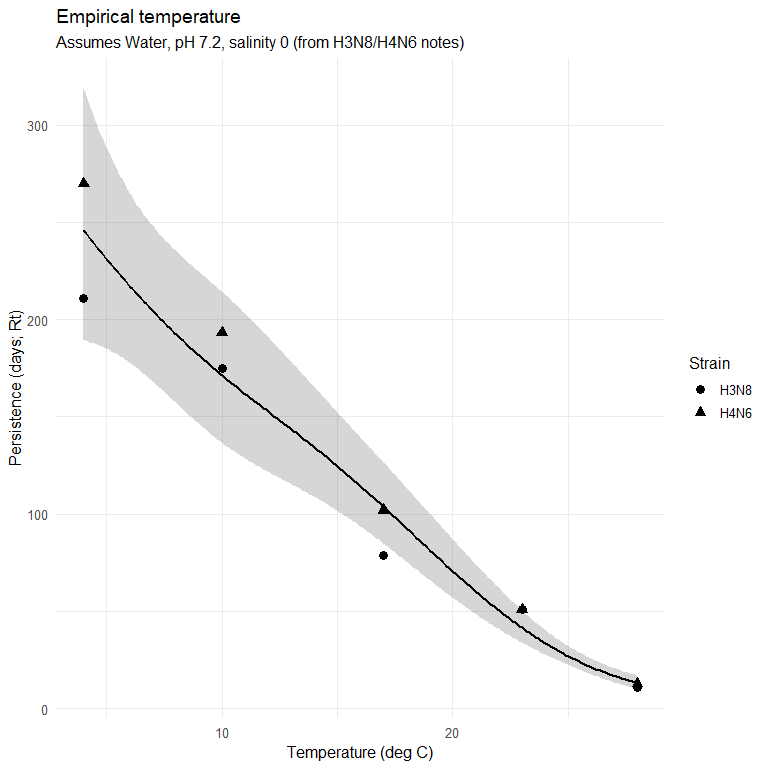
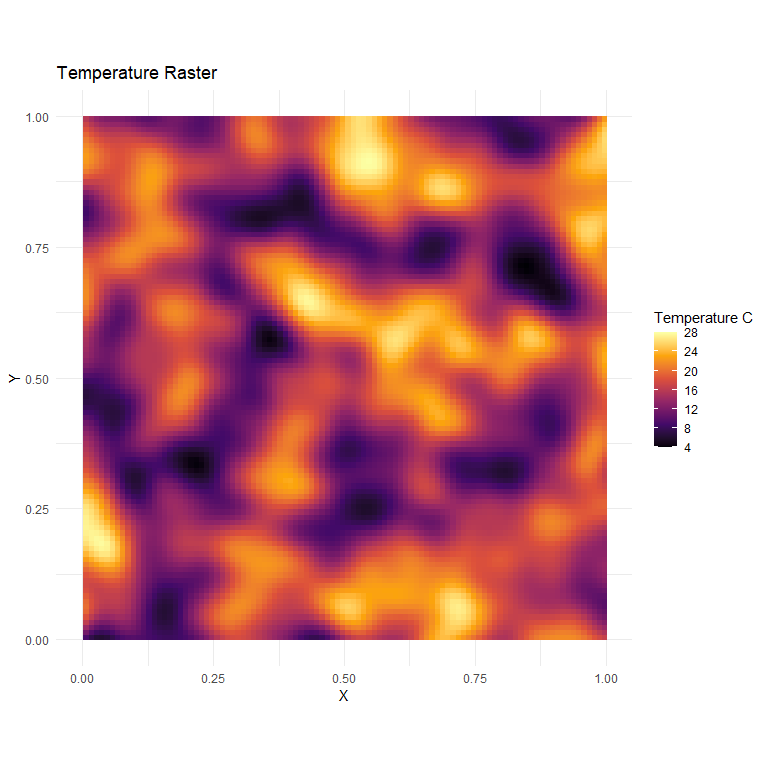
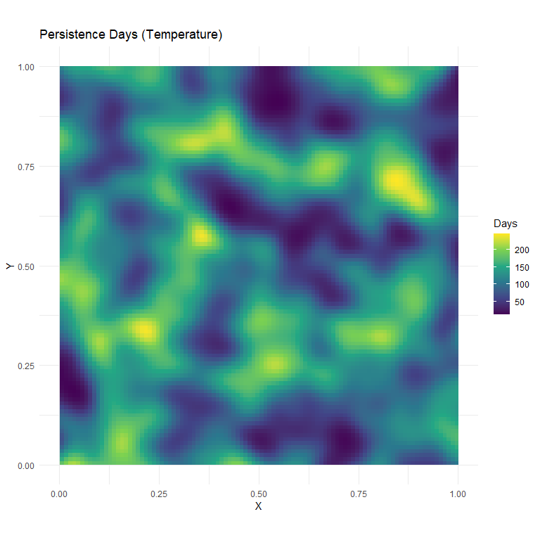
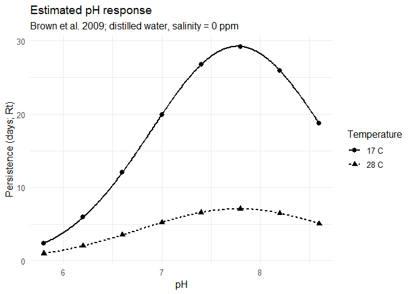
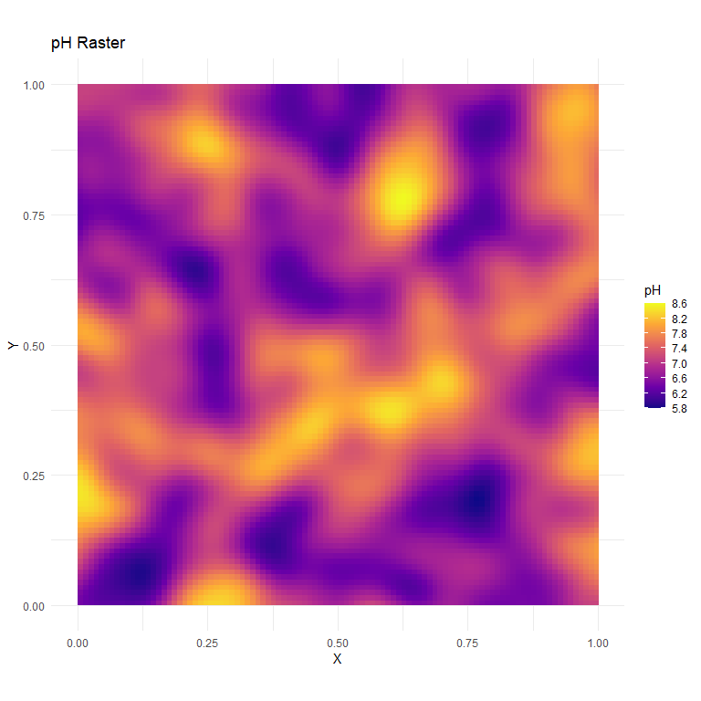
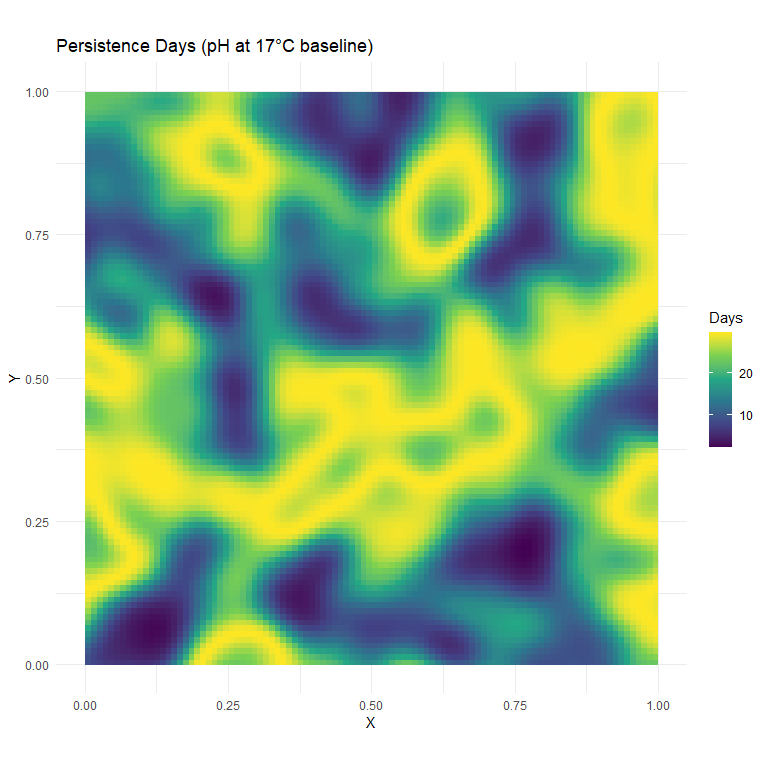
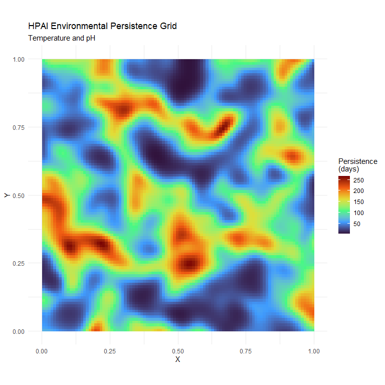

Environmental Persistence Model Concept
================

- <a href="#overview" id="toc-overview">Overview</a>
- <a href="#load-libraries" id="toc-load-libraries">Load Libraries</a>
- <a href="#random-seed" id="toc-random-seed">Random Seed</a>
- <a href="#param-notebook" id="toc-param-notebook">Param Notebook</a>
- <a href="#temperature" id="toc-temperature">Temperature</a>
- <a href="#temperature-response-function"
  id="toc-temperature-response-function">Temperature-response Function</a>
- <a href="#ph-influence" id="toc-ph-influence">pH Influence</a>
- <a href="#joint-temperature-and-ph-model"
  id="toc-joint-temperature-and-ph-model">Joint Temperature and pH
  Model</a>
- <a href="#combined-persistence-in-space"
  id="toc-combined-persistence-in-space">Combined Persistence in Space</a>
- <a href="#final-persistence-surface"
  id="toc-final-persistence-surface">Final Persistence Surface</a>

## Overview

This script illustrates a toy model of environmental HPAI persistence
based on temperature and pH values from literature.

### Objectives

1.  Demonstrate basic GAM model architecture.  
2.  Fit an temperature-response curve using numeric value ranges.
3.  Demo how to apply the model to a spatial grid.  
4.  Fit a pH-response curve using numeric value ranges.
5.  Demo how to apply the pH model to a spatial grid.  
6.  Fit a GAM with both temperature and pH.  
7.  Predict a combined temperature and pH peristence surface.

## Load Libraries

<details open>
<summary>Hide code</summary>

``` r
library(readxl) # read excel file
library(readr) # read excel from link
library(dplyr) # data wrangling
library(tidyr) # data wrangling
library(here) # directory path management
library(ggplot2) # plotting
library(mgcv) # fitting mixed models, using non-linear variables
library(scales) # plotting/transforms
library(terra) # spatial data
library(ambient) # create spatial clusters (less boring rasters)
```

</details>

## Random Seed

For reproducibility.

<details open>
<summary>Hide code</summary>

``` r
set.seed(20261020)
```

</details>

## Param Notebook

Read the older parameter table from Google Drive. This is a demo of
accessing remote data.

<details open>
<summary>Hide code</summary>

``` r
sheet_id <- "1G3oi49CyQRwj5r6bzqXyJCIPs-Vune5wbCTYWWISokM"
sheet_name <- "Env Factors" # first tab

# URL for the first Excel tab
export_url <- sprintf(
  "https://docs.google.com/spreadsheets/d/%s/gviz/tq?tqx=out:csv&sheet=%s",
  sheet_id,
  URLencode(sheet_name)
)

# Read into a dataframe
factors_raw <- read_csv(export_url)
```

</details>

    New names:
    Rows: 42 Columns: 27
    ── Column specification
    ──────────────────────────────────────────────────────── Delimiter: "," chr
    (9): Environmental Factor, Study, Substrate(s), Experimental Conditions... lgl
    (18): ...10, ...11, ...12, ...13, ...14, ...15, ...16, ...17, ...18, ......
    ℹ Use `spec()` to retrieve the full column specification for this data. ℹ
    Specify the column types or set `show_col_types = FALSE` to quiet this message.
    • `` -> `...10`
    • `` -> `...11`
    • `` -> `...12`
    • `` -> `...13`
    • `` -> `...14`
    • `` -> `...15`
    • `` -> `...16`
    • `` -> `...17`
    • `` -> `...18`
    • `` -> `...19`
    • `` -> `...20`
    • `` -> `...21`
    • `` -> `...22`
    • `` -> `...23`
    • `` -> `...24`
    • `` -> `...25`
    • `` -> `...26`
    • `` -> `...27`

<details open>
<summary>Hide code</summary>

``` r
# check the data
head(factors_raw)
```

</details>

    # A tibble: 6 × 27
      `Environmental Factor` Study             `Substrate(s)` Experimental Conditi…¹
      <chr>                  <chr>             <chr>          <chr>                 
    1 Temperature            Beato et al. 2012 Poultry meat   4C & 20C              
    2 pH                     Beato et al. 2012 Poultry meat   pH 5 and 7 (4C and 20…
    3 Temperature            Brown J et al. 2… Water (distil… 11 H5 HPAI isolates; …
    4 Temperature            Brown JD et al. … Water (distil… Temp = 4, 10, 17, 20,…
    5 pH                     Brown JD et al. … Water (distil… pH = 5.8, 6.2, 6.6, 7…
    6 Salinity               Brown JD et al. … Water (distil… salinity = 0, 5, 10, …
    # ℹ abbreviated name: ¹​`Experimental Conditions / Tolerances`
    # ℹ 23 more variables: `Duration / D-value / Endpoint` <chr>,
    #   `Key Finding` <chr>, Notes <chr>, Link <chr>, `Data Extracted?` <chr>,
    #   ...10 <lgl>, ...11 <lgl>, ...12 <lgl>, ...13 <lgl>, ...14 <lgl>,
    #   ...15 <lgl>, ...16 <lgl>, ...17 <lgl>, ...18 <lgl>, ...19 <lgl>,
    #   ...20 <lgl>, ...21 <lgl>, ...22 <lgl>, ...23 <lgl>, ...24 <lgl>,
    #   ...25 <lgl>, ...26 <lgl>, ...27 <lgl>

<details open>
<summary>Hide code</summary>

``` r
# environmental categories
if (!is.null(factors_raw)) {
  factor_inventory <- factors_raw %>%
    count(`Environmental Factor`, sort = TRUE)

  print(factor_inventory)
}
```

</details>

    # A tibble: 19 × 2
       `Environmental Factor`                  n
       <chr>                               <int>
     1 Temperature                            11
     2 pH                                      5
     3 <NA>                                    4
     4 Moisture / RH                           3
     5 Salinity                                3
     6 Relative humidity (cold conditions)     2
     7 UV exposure (simulated sunlight)        2
     8 Biological Activity                     1
     9 Freeze–Thaw                             1
    10 Freezing / Thawing cycles               1
    11 Frozen state                            1
    12 Phyisco-chemical                        1
    13 Reassortment Effects                    1
    14 Strain Effects                          1
    15 Temperature (cold)                      1
    16 Temperature (warm + humid)              1
    17 Temperature (warm)                      1
    18 Temperature/pH/Salinity                 1
    19 UV / Sunlight                           1

## Temperature

Temperature data from the workbook. Looking at *Lebarbenchon et
al. 2011* especially.

**Example Ranges:** Assumptions: in Water with pH = 7.2 and salinity = 0
Rt = Number of days for a 1-log10 TCID50/mL decrease.

Values from notes, temp=days:  
H3N8: 4C=211, 10C=175, 17C=79, 23C=51, 28C=11  
H4N6: 4C=270, 10C=193, 17C=102, 23C=51, 28C=13

Set up strain-specific table with temperature and days persistent. We
could average, but might check strain differences later.

<details open>
<summary>Hide code</summary>

``` r
temperature_evidence <- tibble::tribble(
  ~strain, ~temp_c, ~persistence_days,
  "H3N8",      4,              211,
  "H3N8",     10,              175,
  "H3N8",     17,               79,
  "H3N8",     23,               51,
  "H3N8",     28,               11,
  "H4N6",      4,              270,
  "H4N6",     10,              193,
  "H4N6",     17,              102,
  "H4N6",     23,               51,
  "H4N6",     28,               13
)

print(temperature_evidence)
```

</details>

    # A tibble: 10 × 3
       strain temp_c persistence_days
       <chr>   <dbl>            <dbl>
     1 H3N8        4              211
     2 H3N8       10              175
     3 H3N8       17               79
     4 H3N8       23               51
     5 H3N8       28               11
     6 H4N6        4              270
     7 H4N6       10              193
     8 H4N6       17              102
     9 H4N6       23               51
    10 H4N6       28               13

## Temperature-response Function

Example here using a GAM because we don\`t assume that persistence
changes linearly with temperature. The GAM allows the predictor to have
a flexible, data-driven smooth shape.

The response variable (persistence_days) is log-transformed. This is
common for duration type variables that are only positive, right-skewed,
or represent exponential decay processes (e.g., pathogen persistence).

Note that a family argument (e.g., Poisson, Gamma) isn\`t specified in
the *gam()*; this means it defaults to a Gaussian distribution (it
assumes model errors are normally distributed).

The *s()* code indicates we want to temp_c to a be a spline
(non-linear), in this case with k=4 dimensions (max degrees of freedom).
A little curvy, but not too much. Increasing k will make it more curvy.

The *REML* refers tells the model to use Restricted Maximum Likelihood
when estimating the smoothing parameter, which tries to balance
smoothness and closeness to the data.

### Run the model:

<details open>
<summary>Hide code</summary>

``` r
fit_temp <- gam(
  log(persistence_days) ~ s(temp_c, k = 4),
  data = temperature_evidence,
  method = "REML"
)

print(summary(fit_temp))
```

</details>


    Family: gaussian 
    Link function: identity 

    Formula:
    log(persistence_days) ~ s(temp_c, k = 4)

    Parametric coefficients:
                Estimate Std. Error t value Pr(>|t|)    
    (Intercept)  4.31987    0.06121   70.57 1.92e-10 ***
    ---
    Signif. codes:  0 '***' 0.001 '**' 0.01 '*' 0.05 '.' 0.1 ' ' 1

    Approximate significance of smooth terms:
                edf Ref.df     F  p-value    
    s(temp_c) 2.642  2.904 103.5 1.15e-05 ***
    ---
    Signif. codes:  0 '***' 0.001 '**' 0.01 '*' 0.05 '.' 0.1 ' ' 1

    R-sq.(adj) =  0.971   Deviance explained = 97.9%
    -REML = 2.5894  Scale est. = 0.037471  n = 10

We have the model, now lets predict to the observed range with equal
intervals.

<details open>
<summary>Hide code</summary>

``` r
range(temperature_evidence$temp_c)
```

</details>

    [1]  4 28

<details open>
<summary>Hide code</summary>

``` r
temp_grid_observed <- tibble(
  temp_c = seq(4, 28, by = 0.1)
)

# predict persistence for each value
pred_temp_link <- predict(
  fit_temp,
  newdata = temp_grid_observed,
  se.fit = TRUE,
  type = "link"
)


# create a dataframe
temp_grid_observed <- temp_grid_observed %>%
  mutate(
    log_days = as.numeric(pred_temp_link$fit),
    se_log_days = as.numeric(pred_temp_link$se.fit),
    predicted_days = exp(log_days),
    lower_95 = exp(log_days - 1.96 * se_log_days),
    upper_95 = exp(log_days + 1.96 * se_log_days)
  )
```

</details>

### Temperature-response Curve

<details open>
<summary>Hide code</summary>

``` r
p_temperature <- ggplot() +
  geom_ribbon(
    data = temp_grid_observed,
    aes(x = temp_c, ymin = lower_95, ymax = upper_95),
    alpha = 0.2
  ) +
  geom_line(
    data = temp_grid_observed,
    aes(x = temp_c, y = predicted_days),
    linewidth = 1
  ) +
  geom_point(
    data = temperature_evidence,
    aes(x = temp_c, y = persistence_days, shape = strain),
    size = 3
  ) +
  scale_y_continuous(labels = label_number()) +
  labs(
    title = "Empirical temperature",
    subtitle = "Assumes Water, pH 7.2, salinity 0 (from H3N8/H4N6 notes)",
    x = "Temperature (deg C)",
    y = "Persistence (days; Rt)",
    shape = "Strain"
  ) +
  theme_minimal(base_size = 12)

p_temperature
```

</details>



### Temperature in Space

Create a synthetic raster grid representing temperature.

<details open>
<summary>Hide code</summary>

``` r
# resolution and grid dimensions
res <- 100  # 100 x 100 cells
temp.r <- rast(nrows = res, ncols = res, xmin = 0, xmax = 1, ymin = 0, ymax = 1)

# smooth 2D simplex noise for spatial clustering
coords <- crds(temp.r)
noise <- noise_simplex(
  dim = c(res, res),
  frequency = 0.03,  # Lower frequency = larger cluster sizes
  octaves = 2
)

# rescale noise to [0, 1]
norm_vals <- (noise - min(noise)) / (max(noise) - min(noise))

# map to the range and round to the nearest 0.1
target_vals <- 4 + norm_vals * (28 - 4)
snapped_vals <- round(target_vals, 1)

# assign to the raster
values(temp.r) <- snapped_vals

# quick plot
temp.df <- as.data.frame(temp.r, xy = TRUE)
colnames(temp.df)[3] <- "temp_c"

ggplot(temp.df, aes(x = x, y = y, fill = temp_c)) +
  geom_raster() +
  scale_fill_viridis_c(
    name = "Temperature C",
    option = "B",
    limits = c(4, 28),
    breaks = seq(4, 28, by = 4)
  ) +
  coord_fixed(ratio = 1, xlim = c(0, 1), ylim = c(0, 1)) +
  theme_minimal() +
  labs(
    title = "Temperature Raster",
    x = "X",
    y = "Y"
  )
```

</details>



### Temperature Persistence

Predict persistence based on values in temperature raster.

<details open>
<summary>Hide code</summary>

``` r
# predict values from raster
temp_persist.df <- predict(
  fit_temp,
  newdata = temp.df["temp_c"], 
  se.fit = FALSE,
  type = "link")

temp.df$temp_persist <- exp(as.numeric(temp_persist.df))

# copy raster
temp_persist.r <- temp.r
values(temp_persist.r) <- temp.df$temp_persist

# quick plot
temp_persist.df <- as.data.frame(temp_persist.r, xy = TRUE)
colnames(temp_persist.df)[3] <- "Days_temp"

ggplot(temp_persist.df, aes(x = x, y = y, fill = Days_temp)) +
  geom_raster() +
  scale_fill_viridis_c(
    name = "Days",
    option = "D",
   ) +
  coord_fixed(ratio = 1, xlim = c(0, 1), ylim = c(0, 1)) +
  theme_minimal() +
  labs(
    title = "Persistence Days (Temperature)",
    x = "X",
    y = "Y"
  )
```

</details>



## pH Influence

THe pH data range below was from a paper cited in the Excel:  
Justin D. Brown, Ginger Goekjian, Rebecca Poulson, Steve Valeika, David
E. Stallknecht,  
Avian influenza virus in water: Infectivity is dependent on pH, salinity
and temperature,  
Veterinary Microbiology, Volume 136, Issues 1–2, 2009,  
https://doi.org/10.1016/j.vetmic.2008.10.027.

Recreate info given in Fig 1 of the paper. They used two temperature
thresholds. First, create functions based on their formulation:

<details open>
<summary>Hide code</summary>

``` r
# possible pH range
ph_values <- c(
  5.8, 6.2, 6.6, 7.0,
  7.4, 7.8, 8.2, 8.6
)

# estimated from Fig 1 in paper @ 17 degrees
ph_response_17 <- function(ph) {
  29.25 * exp(
    -0.5 * ((ph - 7.77) / 0.88)^2
  )
}

# estimated from Fig 1 in paper @ 28 degrees
ph_response_28 <- function(ph) {
  7.08 * exp(
    -0.5 * ((ph - 7.78) / 1.00)^2
  )
}
```

</details>

Now predict across the full range at equal interval.

<details open>
<summary>Hide code</summary>

``` r
ph_grid <- tibble(
  ph = seq(min(ph_values), max(ph_values), by = 0.01)
) %>%
  mutate(
    rt_17 = ph_response_17(ph),
    rt_28 = ph_response_28(ph)
  )

ph_grid
```

</details>

    # A tibble: 281 × 3
          ph rt_17 rt_28
       <dbl> <dbl> <dbl>
     1  5.8   2.39 0.997
     2  5.81  2.45 1.02 
     3  5.82  2.51 1.04 
     4  5.83  2.58 1.06 
     5  5.84  2.64 1.08 
     6  5.85  2.71 1.10 
     7  5.86  2.77 1.12 
     8  5.87  2.84 1.14 
     9  5.88  2.91 1.16 
    10  5.89  2.99 1.19 
    # ℹ 271 more rows

<details open>
<summary>Hide code</summary>

``` r
## pH points for Plotting
ph_evidence_fit <- tibble(
  ph = ph_values,
  rt_17 = ph_response_17(ph),
  rt_28 = ph_response_28(ph)
)
```

</details>

Wrangle the data a bit for a plot:

<details open>
<summary>Hide code</summary>

``` r
ph_predictions <- ph_grid %>%
  tidyr::pivot_longer(
    cols = c(rt_17, rt_28),
    names_to = "Temperature",
    values_to = "persistence_days"
  ) %>%
  mutate(
    Temperature = recode(
      Temperature,
      rt_17 = "17 C",
      rt_28 = "28 C"
    )
  )
```

</details>

### pH Curves

<details open>
<summary>Hide code</summary>

``` r
p_ph <- ggplot(
  ph_predictions,
  aes(
    x = ph,
    y = persistence_days,
    linetype = Temperature
  )
) +
  geom_line(linewidth = 1) +
  labs(
    title = "Estimated pH response",
    subtitle = "Brown et al. 2009; distilled water, salinity = 0 ppm",
    x = "pH",
    y = "Persistence (days; Rt)",
    linetype = "Temperature"
  ) +
  theme_minimal(base_size = 12)

p_ph +
  geom_point(
    data = ph_evidence_fit %>%
      pivot_longer(
        cols = c(rt_17, rt_28),
        names_to = "Temperature",
        values_to = "persistence_days"
      ) %>%
      mutate(
        Temperature = recode(
          Temperature,
          rt_17 = "17 C",
          rt_28 = "28 C"
        )
      ),
    aes(
      x = ph,
      y = persistence_days,
      shape = Temperature
    ),
    size = 2.5
  )
```

</details>



### pH in Space

Now for the raster version.

<details open>
<summary>Hide code</summary>

``` r
# synthetic clustered pH raster across range [5.8, 8.6]
ph.r <- rast(nrows = res, ncols = res, xmin = 0, xmax = 1, ymin = 0, ymax = 1)

# a little spatial heterogeneity
noise_ph <- noise_simplex(
  dim = c(res, res),
  frequency = 0.025,
  octaves = 2
)

# rescale noise to [0, 1] and then map to pH range [5.8, 8.6]
norm_ph <- (noise_ph - min(noise_ph)) / (max(noise_ph) - min(noise_ph))
target_ph <- min(ph_values) + norm_ph * (max(ph_values) - min(ph_values))
values(ph.r) <- round(target_ph, 2)

# dataframe for plotting
ph.df <- as.data.frame(ph.r, xy = TRUE)
colnames(ph.df)[3] <- "ph"

ggplot(ph.df, aes(x = x, y = y, fill = ph)) +
  geom_raster() +
  scale_fill_viridis_c(
    name = "pH",
    option = "C",
    limits = c(5.8, 8.6),
    breaks = seq(5.8, 8.6, by = 0.4)
  ) +
  coord_fixed(ratio = 1, xlim = c(0, 1), ylim = c(0, 1)) +
  theme_minimal() +
  labs(
    title = "pH Raster",
    x = "X",
    y = "Y"
  )
```

</details>



### pH Persistence

<details open>
<summary>Hide code</summary>

``` r
# pH Model, example with 17 degree baseline
fit_ph <- gam(
  log(persistence_days) ~ s(ph, k = 5),
  data = ph_predictions %>% filter(Temperature == "17 C"),
  method = "REML"
)

# predict standalone pH persistence across raster cells
ph_pred_link <- predict(
  fit_ph,
  newdata = ph.df["ph"],
  se.fit = FALSE,
  type = "link"
)

# pull predictions
ph.df$ph_persist <- exp(as.numeric(ph_pred_link))

# pH persistence raster
ph_persist.r <- ph.r # copy
values(ph_persist.r) <- ph.df$ph_persist # repalce values

ggplot(as.data.frame(ph_persist.r, xy = TRUE), aes(x = x, y = y, fill = lyr.1)) +
  geom_raster() +
  scale_fill_viridis_c(name = "Days", option = "D") +
  coord_fixed(ratio = 1, xlim = c(0, 1), ylim = c(0, 1)) +
  theme_minimal() +
  labs(
    title = "Persistence Days (pH at 17°C baseline)",
    x = "X",
    y = "Y"
  )
```

</details>



## Joint Temperature and pH Model

Put both predictors in a common model.

<details open>
<summary>Hide code</summary>

``` r
# joint dataset
ref_ph_scale <- ph_response_17(7.2) # pH 7.2, relative scaling applied

environment_training <- expand_grid(
  temp_c = seq(4, 28, length.out = 15), # temp range
  ph = seq(5.8, 8.6, length.out = 15) # pH range
) %>%
  mutate(
    # predict temperature
    base_days = exp(as.numeric(predict(fit_temp, newdata = data.frame(temp_c = temp_c)))),
    # scale persistence based on pH
    ph_scaler = ph_response_17(ph) / ref_ph_scale,
    persistence_days = pmax(base_days * ph_scaler, 0.01)
  )
```

</details>

### Fit joint GAM

Includes both temperature and pH

<details open>
<summary>Hide code</summary>

``` r
fit_environment <- gam(
  log(persistence_days) ~ s(temp_c, k = 4) + s(ph, k = 5), # both predictors
  data = environment_training,
  method = "REML"
)

summary(fit_environment)
```

</details>


    Family: gaussian 
    Link function: identity 

    Formula:
    log(persistence_days) ~ s(temp_c, k = 4) + s(ph, k = 5)

    Parametric coefficients:
                Estimate Std. Error t value Pr(>|t|)    
    (Intercept) 3.971558   0.000593    6697   <2e-16 ***
    ---
    Signif. codes:  0 '***' 0.001 '**' 0.01 '*' 0.05 '.' 0.1 ' ' 1

    Approximate significance of smooth terms:
              edf Ref.df      F p-value    
    s(temp_c)   3      3 734457  <2e-16 ***
    s(ph)       4      4 417936  <2e-16 ***
    ---
    Signif. codes:  0 '***' 0.001 '**' 0.01 '*' 0.05 '.' 0.1 ' ' 1

    R-sq.(adj) =      1   Deviance explained =  100%
    -REML = -698.92  Scale est. = 7.9126e-05  n = 225

## Combined Persistence in Space

As before, but now on a raster gri.

<details open>
<summary>Hide code</summary>

``` r
env_stack <- c(temp.r, ph.r) # stack both predictor rasters
names(env_stack) <- c("temp_c", "ph")

# convert to dataframe 
env_grid.df <- as.data.frame(env_stack, xy = TRUE)

# predict (log days) and transform back to natural scale
pred_env_link <- predict(
  fit_environment,
  newdata = env_grid.df[, c("temp_c", "ph")],
  type = "link"
)

# get result
env_grid.df$persistence_days <- exp(as.numeric(pred_env_link))

# back into raster
final_persist.r <- rast(temp.r)
values(final_persist.r) <- env_grid.df$persistence_days
names(final_persist.r) <- "persistence_days"
```

</details>

## Final Persistence Surface

Estimated persistence based on temperature and pH influences from
literature

<details open>
<summary>Hide code</summary>

``` r
ggplot(env_grid.df, aes(x = x, y = y, fill = persistence_days)) +
  geom_raster() +
  scale_fill_viridis_c(
    name = "Persistence\n(days)",
    option = "turbo"
  ) +
  coord_fixed(ratio = 1, xlim = c(0, 1), ylim = c(0, 1)) +
  theme_minimal() +
  labs(
    title = "HPAI Environmental Persistence Grid",
    subtitle = "Temperature and pH",
    x = "X",
    y = "Y"
  )
```

</details>


